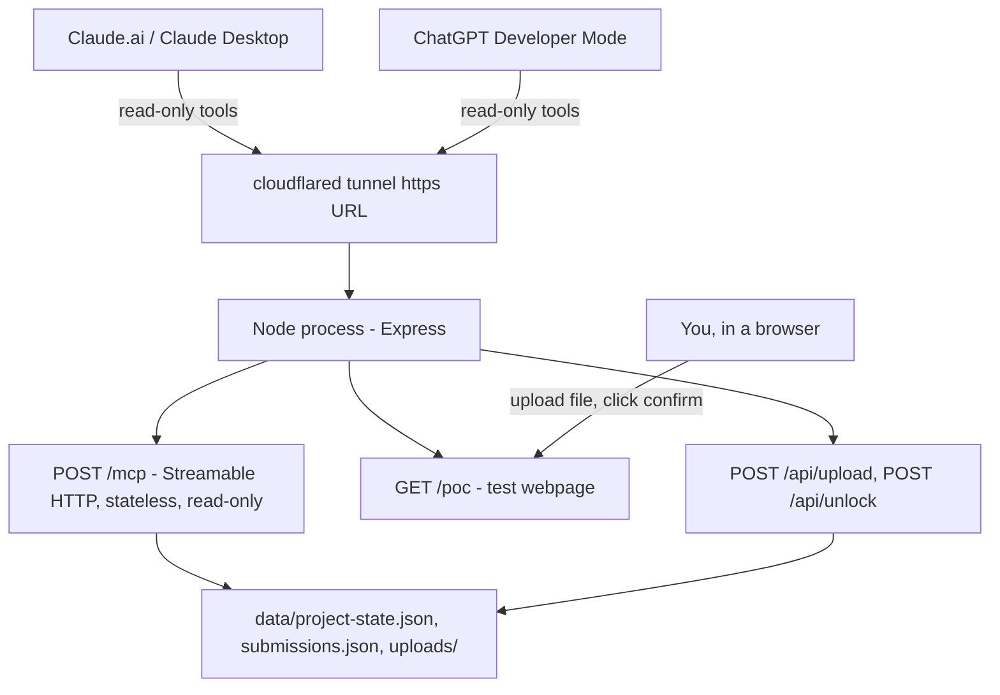

# AI Catalyst Remote MCP + Website Unlock POC

A minimal, throwaway Remote MCP server that validates one narrow question:

> Can the same Remote MCP server serve both Claude and ChatGPT with **read-only** access to a founder's AI Catalyst project state, while a small test website - not either AI - is the only thing that can accept a real submission, validate it for real, and unlock the next module?

This is the second revision of this POC. The first revision (stdio-only, local Claude Desktop config, `save_artifact`/`complete_module` tools that let Claude mutate state directly) is superseded by this one. This revision intentionally does **not** connect to Google Drive, PostgreSQL, the Next.js app, Better Auth, or a production auth system. Storage is local JSON files under `data/` (gitignored). See [`../../packages/toolkit-content/manifest.json`](../../packages/toolkit-content/manifest.json) for the real module list this POC's `module-01-pressure-test` / `module-02-hmw` ids come from.

## The boundary this POC tests



One Express app, one Node process, one `data/` directory. No FastAPI, no Next.js involvement in this POC.

## The 4 MCP tools (read-only / advisory - none of them can mutate anything)

| Tool | Purpose |
|---|---|
| `get_current_module` | Resolves priority `in_progress` -> `needs_revision` -> `ready_to_unlock`; **never** returns a `locked` module. Call this first to find out what module_id to ask about. |
| `get_module_context` | `module_id` is **required** - finding "the current module" is `get_current_module`'s job only. Returns objective, description, required filename, required sections, output rules. Refuses `MODULE_LOCKED` if the module hasn't been unlocked yet, even if you already know its id. |
| `get_latest_validation_feedback` | Reads the most recent website submission's `validation_status` + `issues` for a module. `module_id` optional, defaults to the current module. |
| `check_draft` | Pre-checks draft Markdown against a module's required sections with **zero persistence**. Always returns `draft_check_only: true, can_unlock_module: false` so it can never be mistaken for a real submission. |

Not exposed via MCP at all: no `save_artifact`, `complete_module`, `set_module_status`, or `unlock_module` tool. Claude/ChatGPT have zero mutation capability over `/mcp`.

## Website-only routes (human-triggered HTTP, not MCP)

| Route | Purpose |
|---|---|
| `GET /poc` | The test webpage - module list, upload form, unlock button, log. |
| `GET /api/state` | Current `project-state.json` + `submissions.json`, for the page to render. |
| `POST /api/upload` | Body `{ module_id, filename, content }`. Filename must equal the module's required filename exactly (`INVALID_FILENAME` / `UNEXPECTED_ARTIFACT_FILENAME` otherwise - the server owns the naming rule, not the caller). Only accepted while the module is `in_progress` or `needs_revision`. Runs the same validator as `check_draft`, writes a new version, and sets status to `needs_revision` (failed) or `ready_to_unlock` (passed) - **never** `completed` directly. |
| `POST /api/unlock` | Takes **no target module from the request body at all**. The server finds whichever module is `ready_to_unlock`, re-verifies its latest submission actually passed, computes the next module from the manifest order, and atomically flips current -> `completed` and next -> `in_progress`. Refuses a double-unlock if the next module isn't currently `locked`. |

`validation passed` and `module unlocked` are two different, separately observable states (`ready_to_unlock` vs `completed`) - a passing upload alone never unlocks anything; only a website confirm-click does.

## Module status lifecycle

```text
locked -> in_progress -> (needs_revision | ready_to_unlock) -> completed
```

## Data model

```typescript
type ModuleStatus = "locked" | "in_progress" | "needs_revision" | "ready_to_unlock" | "completed";
type ProjectState = { project_id: string; project_name: string; modules: { module_id: string; status: ModuleStatus }[] };
type SubmissionRecord = {
  submission_id: string; project_id: string; module_id: string; version: number;
  filename: string; file_path: string; validation_status: "passed" | "failed";
  issues: string[]; uploaded_at: string;
};
```

```text
data/
  project-state.json
  submissions.json
  uploads/
    demo-project-001/
      Pressure-Test Verdict.v1.md
```

Seed fixture is `demo-project-001` / "Nobel AI", with `module-01-pressure-test` `in_progress` and `module-02-hmw` `locked`. `module-02-hmw` has a real (if minimal) definition in [`src/modules/moduleDefinitions.ts`](src/modules/moduleDefinitions.ts) this time - unlike the prior stdio POC - specifically so the test script can prove `get_module_context` refuses it before unlock and succeeds immediately after.

## Setup

```bash
pnpm --filter @ai-catalyst/mcp-server build
```

`AI_CATALYST_REPO_ROOT` must point at the monorepo root (so the server can find `packages/toolkit-content/manifest.json`) whenever the working directory isn't already the repo root.

### Reset / seed scripts

```bash
pnpm --filter @ai-catalyst/mcp-server seed   # non-destructive: fills in only what's missing
pnpm --filter @ai-catalyst/mcp-server reset  # destructive: wipes data/, then re-seeds clean
```

`reset` refuses to run unless the resolved path looks like `.../apps/mcp-server/data` (a safety assertion). **Always stop the running server before running `reset`** - this is a single-process, lock-free storage design.

### Run

```bash
pnpm --filter @ai-catalyst/mcp-server start        # HTTP + web UI, http://localhost:8787
pnpm --filter @ai-catalyst/mcp-server start:stdio  # stdio only, for quick local Inspector smoke tests
```

`PORT` env var overrides the default `8787`.

### Optional: `POC_ADMIN_KEY`

`POST /api/upload` and `POST /api/unlock` have **no authentication by default** - see "Known tradeoffs" below. Setting `POC_ADMIN_KEY` before starting the server requires those two routes (and only those two - never `/mcp`) to carry a matching `X-POC-Admin-Key` header. The `/poc` page has an "Admin key" field that attaches this header automatically once filled in.

```bash
POC_ADMIN_KEY=some-random-secret pnpm --filter @ai-catalyst/mcp-server start
```

### Expose it publicly with cloudflared

```bash
cloudflared tunnel --url http://localhost:8787
```

This prints a `https://xxxxx.trycloudflare.com` URL. The MCP endpoint is `<that URL>/mcp`; the test page is `<that URL>/poc`.

## Connecting Claude and ChatGPT

**Claude connects to remote MCP servers exclusively through Customize -> Connectors -> Add custom connector**, pasting in the HTTPS `/mcp` URL. This is true in both Claude.ai and Claude Desktop - it's a cloud-side connection to a remote server, not a local process. This is a **different mechanism from `claude_desktop_config.json`**, which only configures local stdio servers/desktop extensions and cannot point at a remote URL at all - don't try to use it for this.

OAuth Client ID/Secret in that dialog are optional; this POC has no auth on `/mcp`. If an authless custom connector fails to connect (there are occasional reported bugs with non-OAuth custom connectors), the fallback order is:

1. Confirm the remote `/mcp` endpoint itself works, independent of Claude, using MCP Inspector: `npx @modelcontextprotocol/inspector --cli <tunnel-url>/mcp --transport http --method tools/list`.
2. Test the same URL against ChatGPT Developer Mode (Settings -> Apps & Connectors -> Developer mode -> Create app) to isolate whether the problem is server-side or Claude-side.
3. If it's specifically a Claude-connector bug, defer the Claude side of testing, or stand up a minimal OAuth shim later - don't try to route the remote URL through local desktop config.

ChatGPT's custom-connector Developer Mode requires a Plus/Pro/Business/Enterprise/Edu plan.

## The test script (10 steps)

Run `pnpm --filter @ai-catalyst/mcp-server reset` before starting, so every module is in its seeded starting state.

1. Start the server and a tunnel. Add `<tunnel-url>/mcp` to Claude (Customize -> Connectors -> Add custom connector) and, if available, ChatGPT (Developer Mode -> Create app).
2. Both call `get_current_module` -> `module-01-pressure-test` / `in_progress`.
3. Both attempt `get_module_context({ module_id: "module-02-hmw" })` -> both get `MODULE_LOCKED`. Neither AI can preview the next module's requirements before unlock.
4. On `/poc`, upload a draft missing "Next Actions" -> `module-01-pressure-test` -> `needs_revision`, `module-02-hmw` stays `locked`.
5. Both AIs read the issue list via `get_latest_validation_feedback` and help fix the draft (optionally sanity-checking the fix with `check_draft` first - it never mutates anything).
6. Upload the corrected version via `/poc` -> `module-01-pressure-test` -> `ready_to_unlock`, `module-02-hmw` still `locked`.
7. Both AIs call `get_module_context({ module_id: "module-02-hmw" })` again -> **still** `MODULE_LOCKED`. Passing validation does not unlock anything.
8. Click "Confirm and unlock Module 2" on `/poc` -> `module-01-pressure-test` -> `completed`, `module-02-hmw` -> `in_progress`.
9. Both AIs call `get_current_module` again -> now see `module-02-hmw` / `in_progress`.
10. Both AIs call `get_module_context({ module_id: "module-02-hmw" })` again -> now succeeds, returning Module 2's real objective/required filename/required sections.

Steps 3 and 7 vs step 10 are the core proof: the same tool, same arguments, same two AI clients, a different result purely because the website changed server-side state - never because either AI asked more nicely or a different client tried.

### Error cases worth exercising manually (via Inspector or curl against `/mcp` and the web routes)

- `get_module_context` / `get_latest_validation_feedback` / `check_draft` with an unknown `project_id` or `module_id`.
- `POST /api/upload` with a path-traversal filename (`../../evil.md`) -> `INVALID_FILENAME`.
- `POST /api/upload` with the wrong filename for the module -> `UNEXPECTED_ARTIFACT_FILENAME`.
- `POST /api/upload` targeting a `locked` or `ready_to_unlock`/`completed` module -> `MODULE_NOT_ACCEPTING_UPLOADS`.
- `POST /api/unlock` with nothing `ready_to_unlock` -> `NO_MODULE_READY`.
- `POST /api/unlock` called twice in a row -> the second call gets `NO_MODULE_READY` (or `NEXT_MODULE_NOT_LOCKED` if something is already unlocked out of band).
- Malformed JSON body to either `/mcp` or the web routes -> a clean `400 { error_code: "INVALID_JSON_BODY" }`, never an HTML stack trace.
- `GET /mcp` and `DELETE /mcp` -> `405`.

## Known tradeoffs (not blocking, but worth knowing going in)

- **DNS rebinding / origin protection is off.** `createMcpExpressApp({ host: "0.0.0.0" })` only enables that protection automatically for localhost hosts; binding `0.0.0.0` (required for the tunnel to reach it) disables it. Acceptable for a throwaway POC with no mutating MCP tools, not something to carry into production.
- **This POC validates tool/product boundaries, not user authorization.** The accurate claim is "Claude and ChatGPT have no upload/unlock tool over MCP; a tester uses the website to upload and unlock" - **not** "only a human can unlock." `/api/upload` and `/api/unlock` have no authentication unless `POC_ADMIN_KEY` is set, and even then it's a single shared secret, not real per-user auth - anyone with the tunnel URL (and the key, if set) could call them directly with `curl`. `POC_ADMIN_KEY` is a lightweight testing convenience against accidental interference, not production security.
- **Claude's remote connector setup is a cloud-side "Add custom connector" flow**, entirely separate from `claude_desktop_config.json` (which is local-stdio-only and cannot point at a remote URL). See "Connecting Claude and ChatGPT" above for the fallback order if an authless connector won't connect.
- **ChatGPT Developer Mode requires a paid plan.** If unavailable, the ChatGPT half of every step in the test script is skipped, but the full script with Claude alone still fully validates the architecture.
- **Upload is JSON `{ filename, content }`, not a real multipart file POST.** The page still presents a file picker and reads it client-side with `FileReader`, so there's no functional difference to the tester - this just avoids adding `multer` for a throwaway POC.
- A `trycloudflare.com` quick tunnel URL is temporary and re-generated every time `cloudflared tunnel --url ...` is (re)started - re-add the connector URL in Claude/ChatGPT if you restart the tunnel.

## What this explicitly does not do

No FastAPI calls, no Postgres, no Google Drive, no real user auth, no Next.js wiring - this is a risk-lowest-first protocol test of exactly one property: a Remote MCP server can serve multiple AI clients read-only project state while a separate website exclusively owns every mutation. Swapping [`src/storage/repository.ts`](src/storage/repository.ts) / [`src/storage/jsonStore.ts`](src/storage/jsonStore.ts) for real API calls, and adding real authentication to the web routes, are the intended next steps - isolated to those files plus [`src/web/routes.ts`](src/web/routes.ts).
